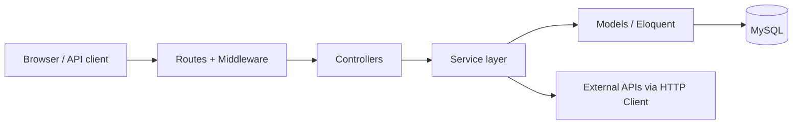

# Architecture

| Layer | Responsibility | Examples |
|---|---|---|
| Routes + Middleware | URL mapping, authentication, role check, throttling | `auth`, `role:admin,operator`, `throttle` |
| Form Requests | Input validation | `LoginRequest`, `RegisterRequest` |
| Controllers | Thin HTTP handling only: receive, call a service, return a response | `AuthController`, `DashboardController` |
| Policies | Per-record authorization ("customer sees only own shipments") | `ShipmentPolicy` (P9) |
| Services | Business rules and database transactions | `ShipmentService`, `TrackingService`, `EtaService`, `ExceptionService` |
| Models | Data and relations | `User`, `Shipment`, `TrackingEvent`, ... |
| External services | Geocoding and weather with timeout and error handling | HTTP Client wrappers (P12) |

## Key decisions

1. **Controllers stay thin.** Business rules live in services so they can be tested without HTTP.
2. **Roles are checked on the server** by the `role` middleware and by Policies. Hiding a button is never the only protection.
3. **`role` is not mass-assignable.** Public registration always creates a customer.
4. **Delay rules are data, not code.** Thresholds are read from the `settings` table.
5. **Tracking events are append-only** so history cannot be rewritten.
6. **Multi-step writes use `DB::transaction`** so a failure leaves no half-created data.
7. **API errors are JSON** (`shouldRenderJsonWhen` for `api/*`), without stack traces.
8. **Single theme file.** All colors are defined once in `resources/css/app.css`.
