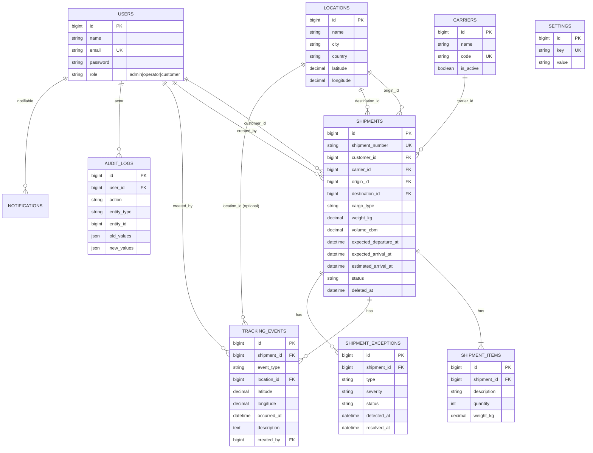

# Database design (ERD)

Ten tables: the nine required by the brief plus `settings` for configurable delay rules.
In-app notifications use Laravel's built-in `notifications` table (polymorphic to the user).

## Cardinality and design decisions

- **User → Shipments (1:N).** A customer owns many shipments; each shipment has exactly one customer. `created_by` records the staff member.
- **Carrier → Shipments (1:N).** A carrier handles many shipments.
- **Location → Shipments (1:N twice).** Origin and destination are separate foreign keys to the same table.
- **Shipment → Items (1:N, at least one).** Items are created together with the shipment inside one database transaction.
- **Shipment → Tracking events (1:N).** Append-only history; no update or delete.
- **Shipment → Exceptions (1:N).** A shipment can have several exceptions over its life.
- **Soft delete** only on `shipments`, because history must survive an Admin delete. Other tables do not need it.
- **Indexes** on `shipments.status`, `shipments.customer_id`, `shipments.expected_arrival_at`, `tracking_events(shipment_id, occurred_at)`, `users.role`.
- **Unique** `shipments.shipment_number`, `carriers.code`, `users.email`, `settings.key`.
- Coordinates stored as `decimal(10,7)` consistently for every table.
